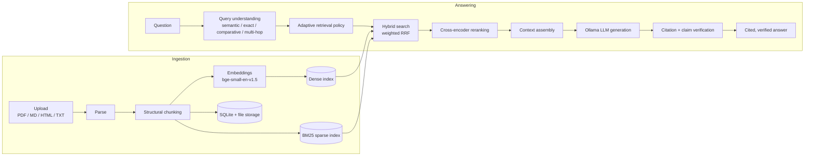

<div align="center">

# NORAG

### Next-generation Orchestrated Retrieval-Augmented Generation

Ask questions about your own documents and get **grounded, cited, verified answers** — running **100% locally** on your machine.

[](https://www.python.org/)
[](https://fastapi.tiangolo.com/)
[](https://www.uvicorn.org/)
[](https://docs.pydantic.dev/)
[](https://www.sqlite.org/)
[](https://ollama.com/)
[](https://github.com/qdrant/fastembed)
[](https://react.dev/)
[](https://www.typescriptlang.org/)
[](https://vite.dev/)
[](https://reactrouter.com/)
[](https://nodejs.org/)
[](https://docs.astral.sh/uv/)
[](https://pytest.org/)
[](https://docs.astral.sh/ruff/)
[](https://eslint.org/)
[](https://prettier.io/)
[](LICENSE)

</div>

---

## Table of Contents

- [What is NORAG?](#what-is-norag)
- [Features](#features)
- [How it works](#how-it-works)
- [Tech stack](#tech-stack)
- [Prerequisites](#prerequisites)
- [Quick start](#quick-start)
- [Running in development mode](#running-in-development-mode)
- [Using NORAG](#using-norag)
- [REST API](#rest-api)
- [Configuration](#configuration)
- [Project structure](#project-structure)
- [Testing and code quality](#testing-and-code-quality)
- [Troubleshooting](#troubleshooting)
- [Contributing](#contributing)
- [License](#license)
- [Author](#author)

---

## What is NORAG?

**NORAG** is a complete Retrieval-Augmented Generation (RAG) system with a web UI. You upload documents (PDF, Markdown, HTML, or plain text), and NORAG lets you ask questions about them. Instead of a single fixed search step, it **orchestrates** several retrieval strategies, adapts to the kind of question you ask, and then **verifies** that the generated answer is actually backed by your documents.

Everything runs on your own computer: embeddings and reranking use local models through FastEmbed, and answer generation uses a local LLM through [Ollama](https://ollama.com/). No data leaves your machine and no API keys are required.

## Features

- **Hybrid retrieval**: dense vector search (semantic) combined with BM25 sparse search (exact keywords), merged with weighted Reciprocal Rank Fusion.
- **Adaptive query routing**: each question is classified as *semantic*, *exact*, *comparative*, or *multi-hop*, and the dense/sparse weighting and candidate count are tuned accordingly.
- **Neural reranking**: a local cross-encoder reorders the retrieved candidates for better precision.
- **Grounded generation**: answers are generated from an assembled, token-budgeted context using a local Ollama model.
- **Answer verification**: citations are validated and individual claims are checked against the retrieved evidence (fast lexical check, or an LLM judge via Ollama).
- **Document management**: upload, list, download, and delete documents. Content hashing prevents duplicate uploads. Data persists in SQLite and survives restarts.
- **Built-in retrieval evaluation**: measure Recall@K, Precision@K, MRR@K, and nDCG@K for `dense`, `sparse`, `hybrid`, and `hybrid_rerank` systems.
- **Modern web UI**: Overview, Documents, Retrieval playground, Ask, and Evaluation pages.
- **Production-minded API**: optional API-key auth, CORS control, rate limiting, request logging, `/health` and `/ready` probes, and upload validation (type, size, encoding).
- **Well tested**: 360+ test functions covering parsing, chunking, retrieval, reranking, verification, and the API.

## How it works



1. **Ingest**: documents are parsed, split into structure-aware chunks (about 400 tokens, 50 overlap), embedded, and added to both a dense vector index and a BM25 index. Originals and metadata are saved to disk so the indexes can be rebuilt automatically on the next start.
2. **Understand**: the query classifier decides what kind of question this is and picks a retrieval plan (candidate count and dense/sparse weights).
3. **Retrieve and rerank**: dense and sparse results are fused, then reranked by a cross-encoder.
4. **Generate**: the best passages are assembled into a prompt and sent to your local Ollama model.
5. **Verify**: citations and claims in the answer are checked against the evidence, and the full trace (retrieval, context, prompt, verification) is returned to the UI.

## Tech stack

| Layer | Technology |
| --- | --- |
| **Backend** | Python 3.11+, FastAPI, Uvicorn, Pydantic / pydantic-settings, httpx |
| **Retrieval** | FastEmbed (`BAAI/bge-small-en-v1.5` embeddings, `Xenova/ms-marco-MiniLM-L-6-v2` reranker), BM25, Reciprocal Rank Fusion |
| **Generation** | Ollama (default model: `qwen3:1.7b`) |
| **Document parsing** | pypdf, markdown-it-py, BeautifulSoup4 |
| **Storage** | SQLite + local file system |
| **Frontend** | React 19, TypeScript, Vite, React Router, react-markdown, lucide-react |
| **Tooling** | uv, pytest, Ruff, ESLint, Prettier |

## Prerequisites

Install these before you start:

| Tool | Version | Used for | Get it |
| --- | --- | --- | --- |
| **Git** | any recent | cloning the repo | https://git-scm.com/downloads |
| **Python** | 3.11 or newer | backend | https://www.python.org/downloads/ |
| **uv** (recommended) | latest | fast Python setup | https://docs.astral.sh/uv/getting-started/installation/ |
| **Node.js + npm** | 20.19+ (22 LTS recommended) | building the web UI | https://nodejs.org/ |
| **Ollama** | latest | local LLM for answers | https://ollama.com/download |

> **Note:** The repo pins Python `3.14` in `.python-version` for `uv`, which will download it automatically if needed. If you use plain `pip` instead, any Python 3.11+ works.

You also need an internet connection **the first time you run it**, so FastEmbed can download the embedding and reranker models (a few hundred MB at most). After that, everything works offline.

## Quick start

Follow these steps in order. Every command is run from the **repository root** (the `NORAG` folder).

### 1. Clone the repository

```bash
git clone https://github.com/Priyanshu-Technologies/NORAG.git
cd NORAG
```

### 2. Start Ollama and download the language model

Make sure the Ollama app/service is running, then pull the default model:

```bash
ollama pull qwen3:1.7b
```

Check it is available:

```bash
ollama list
```

### 3. Install the backend

**Option A: with uv (recommended)**

```bash
uv sync
```

This creates a `.venv` and installs everything, including the test tools.

**Option B: with pip**

```bash
python -m venv .venv
```

Activate the virtual environment:

| OS / shell | Command |
| --- | --- |
| macOS / Linux | `source .venv/bin/activate` |
| Windows (PowerShell) | `.venv\Scripts\Activate.ps1` |
| Windows (cmd) | `.venv\Scripts\activate.bat` |

Then install:

```bash
pip install -e .
```

### 4. Build the web UI

```bash
cd frontend
npm install
npm run build
cd ..
```

This creates `frontend/dist`, which the backend serves automatically.

### 5. Run NORAG

```bash
# with uv
uv run norag

# or, if you activated the virtual environment (pip install)
norag
# equivalent: python -m norag
```

### 6. Open the app

Go to **http://127.0.0.1:8000** in your browser.

That's it. Head to the **Documents** page, upload a file, and then use the **Ask** page.

> **Important:** Start the server from the repository root. The backend looks for the built UI at `frontend/dist` relative to the folder you run it from.

## Running in development mode

If you want to change the code, run the backend and the frontend separately so you get hot reloading on the UI.

**Terminal 1: backend (port 8000)**

```bash
uv run norag
```

**Terminal 2: frontend dev server (port 5173)**

```bash
cd frontend
npm install
npm run dev
```

Open the URL Vite prints (usually **http://localhost:5173**). The dev server proxies every `/api` request to `http://localhost:8000`, so no extra setup is needed.

Useful frontend commands:

| Command | What it does |
| --- | --- |
| `npm run dev` | start the Vite dev server |
| `npm run build` | type-check and create the production build |
| `npm run preview` | preview the production build |
| `npm run lint` | run ESLint |
| `npm run format` / `npm run format:check` | format or check with Prettier |
| `npm run typecheck` | run the TypeScript compiler checks |

## Using NORAG

The web UI has five pages:

| Page | What you can do |
| --- | --- |
| **Overview** | See your knowledge-base stats (documents, chunks, queries, uploads) and the retrieval architecture. |
| **Documents** | Upload `.pdf`, `.md`, `.html`, or `.txt` files (up to 25 MB each), download the originals, or delete documents. |
| **Retrieval** | Experiment with retrieval configurations and see which passages come back. |
| **Ask** | Ask a question and get an answer with source passages, citation checks, and claim verification. |
| **Evaluation** | Measure retrieval quality (Recall@K, Precision@K, MRR@K, nDCG@K) across `dense`, `sparse`, `hybrid`, and `hybrid_rerank`. |

Suggested first run: upload one document on **Documents**, then open **Ask** and try both a conceptual question ("explain how X works") and an exact-match one ("what is the value of `SOME_IDENTIFIER`?") to see the adaptive routing in action.

## REST API

All endpoints below are under the `/api` prefix. Interactive documentation (Swagger UI) is available at **http://127.0.0.1:8000/docs** while the server is running.

| Method | Endpoint | Description |
| --- | --- | --- |
| `POST` | `/api/documents` | Upload a document (multipart field `file`; add `?replace=true` to replace an existing one) |
| `GET` | `/api/documents` | List documents (supports `limit` and `offset`) |
| `GET` | `/api/documents/{id}/file` | Download the original file |
| `DELETE` | `/api/documents/{id}` | Delete a document and its index entries |
| `POST` | `/api/query` | Ask a question and receive the answer plus the full pipeline trace |
| `GET` | `/api/stats` | Knowledge-base and usage counters |
| `POST` | `/api/evaluate` | Run a retrieval evaluation over labelled queries |
| `GET` | `/health` | Liveness probe |
| `GET` | `/ready` | Readiness probe (database, storage, Ollama) |

**Example: upload a document and ask a question**

```bash
curl -F "file=@my-notes.pdf" http://127.0.0.1:8000/api/documents

curl -X POST http://127.0.0.1:8000/api/query \
  -H "Content-Type: application/json" \
  -d '{"query": "What are the main conclusions?", "top_k": 5}'
```

The optional `system` field in `/api/query` can be `dense`, `sparse`, `hybrid`, or `hybrid_rerank` to override the retrieval strategy.

If you set `NORAG_API_KEY`, send it as an `X-API-Key` header or as `Authorization: Bearer <key>`.

## Configuration

NORAG works out of the box with no configuration. To customise it, set environment variables or create a `.env` file in the repository root. Every setting is prefixed with `NORAG_`.

Example `.env`:

```env
NORAG_OLLAMA_MODEL=qwen3:1.7b
NORAG_API_PORT=8000
NORAG_LOG_LEVEL=INFO
```

| Variable | Default | Description |
| --- | --- | --- |
| `NORAG_API_HOST` | `127.0.0.1` | Host the server binds to |
| `NORAG_API_PORT` | `8000` | Server port |
| `NORAG_API_PREFIX` | `/api` | URL prefix for the REST API |
| `NORAG_API_KEY` | *(none)* | Enables API-key authentication when set |
| `NORAG_CORS_ALLOW_ORIGINS` | *(empty)* | Comma-separated list of allowed CORS origins |
| `NORAG_RATE_LIMIT_PER_MINUTE` | `0` | Per-client rate limit (`0` disables it) |
| `NORAG_ENVIRONMENT` | `development` | Environment label shown in stats and health checks |
| `NORAG_DEBUG` | `true` | Debug mode |
| `NORAG_LOG_LEVEL` | `INFO` | Logging level |
| `NORAG_FRONTEND_DIST_PATH` | `frontend/dist` | Folder containing the built web UI |
| `NORAG_DATABASE_PATH` | `data/norag.sqlite3` | SQLite database location |
| `NORAG_FILE_STORAGE_PATH` | `data/documents` | Where uploaded originals are stored |
| `NORAG_OLLAMA_BASE_URL` | `http://localhost:11434` | Ollama server address |
| `NORAG_OLLAMA_MODEL` | `qwen3:1.7b` | Ollama model used for answers |
| `NORAG_OLLAMA_TIMEOUT_SECONDS` | `120` | Timeout for generation requests |
| `NORAG_OLLAMA_THINK` | `false` | Enable the model's "thinking" mode, if supported |
| `NORAG_OLLAMA_READY_CHECK` | `true` | Include Ollama in the `/ready` check |
| `NORAG_VERIFICATION_STRATEGY` | `lexical` | Claim verification: `lexical` (fast) or `ollama` (LLM judge) |
| `NORAG_CHUNK_TARGET_TOKENS` | `400` | Target chunk size |
| `NORAG_CHUNK_MAX_TOKENS` | `500` | Maximum chunk size |
| `NORAG_CHUNK_OVERLAP_TOKENS` | `50` | Overlap between chunks |
| `NORAG_CONTEXT_MAX_TOKENS` | `3000` | Token budget for retrieved context |
| `NORAG_PROMPT_MAX_INPUT_TOKENS` | `4096` | Maximum prompt size |
| `NORAG_PROMPT_MAX_OUTPUT_TOKENS` | `768` | Maximum generated answer length |
| `NORAG_GENERATION_TEMPERATURE` | `0.2` | Sampling temperature (0 to 2) |
| `NORAG_DEFAULT_TOP_K` | `5` | Default number of passages returned |
| `NORAG_MAX_TOP_K` | `50` | Upper limit for `top_k` |

**Using a different Ollama model:** pull it, then point NORAG at it.

```bash
ollama pull llama3.2
echo "NORAG_OLLAMA_MODEL=llama3.2" >> .env
```

**Frontend variables** (optional, set in `frontend/.env`): `VITE_API_BASE` changes the API base URL (default `/api`), and `VITE_API_KEY` sends an `X-API-Key` header from the UI.

## Project structure

```text
NORAG/
├── pyproject.toml          # Python package, dependencies, pytest and Ruff config
├── uv.lock                 # Locked dependency versions
├── .python-version         # Python version used by uv
├── LICENSE                 # MIT license
├── src/norag/              # Backend package
│   ├── __main__.py         #   `norag` command / `python -m norag` entry point
│   ├── application.py      #   Wires all services together
│   ├── config.py           #   Environment-driven settings
│   ├── api/                #   FastAPI app, routes, schemas, security, middleware
│   ├── ingestion/          #   Parsers for PDF, Markdown, HTML, text
│   ├── chunking/           #   Structure-aware chunking
│   ├── embeddings/         #   FastEmbed embedding provider
│   ├── vector_store/       #   In-memory dense vector index
│   ├── sparse_retrieval/   #   BM25 index and tokenizer
│   ├── hybrid_retrieval/   #   Weighted Reciprocal Rank Fusion
│   ├── query_understanding/#   Query intent classifier and router
│   ├── retrieval_policy/   #   Adaptive retrieval plans
│   ├── reranking/          #   Cross-encoder reranker
│   ├── context/            #   Token-budgeted context assembly
│   ├── prompting/          #   Prompt construction
│   ├── generation/         #   Ollama generation provider
│   ├── verification/       #   Citation validation and claim verification
│   ├── answering/          #   End-to-end answering pipeline
│   ├── evaluation/         #   Recall / Precision / MRR / nDCG metrics
│   └── storage/            #   SQLite repository and file storage
├── frontend/               # React + TypeScript + Vite web UI
│   └── src/                #   Pages: Overview, Documents, Retrieval, Ask, Evaluation
├── tests/                  # pytest test suite
└── scripts/                # Smoke tests and evaluation demos
```

Runtime data (the SQLite database and uploaded files) is stored in `data/`, which is git-ignored.

## Testing and code quality

**Backend tests**

```bash
uv run pytest
```

With pip, install the dev tools first: `pip install pytest ruff reportlab`, then run `pytest`.

> **Note:** Tests that build the full application load the FastEmbed models, so they need an internet connection the first time (the models are then cached). If you are behind a firewall that blocks Hugging Face, those tests and the first server start will fail with `Could not load model ... from any source`.

**Lint and format the backend**

```bash
uv run ruff check .
uv run ruff format .
```

**Frontend checks**

```bash
cd frontend
npm run lint
npm run typecheck
npm run format:check
```

**Demo and smoke scripts** (in `scripts/`)

| Script | Purpose | Needs Ollama? |
| --- | --- | --- |
| `smoke_test_norag.py` | Runs retrieval end to end on a sample document | No |
| `evaluate_retrieval.py` | Compares retrieval systems with ranking metrics | No |
| `test_query_behaviour.py` | Shows how queries are classified and routed | No |
| `test_generation.py` | Tests answer generation | Yes |
| `test_end_to_end.py` | Runs the full pipeline including generation | Yes |

```bash
uv run python scripts/smoke_test_norag.py
```

## Troubleshooting

| Problem | Fix |
| --- | --- |
| Browser shows JSON (`"status": "operational"`) instead of the UI | The UI is not built. Run `cd frontend && npm install && npm run build`, then restart from the repo root. |
| `Answer generation failed` or a `502` error on **Ask** | Ollama is not running or the model is missing. Start Ollama and run `ollama pull qwen3:1.7b`. |
| `/ready` returns `503` / `degraded` | Check the `checks` field in the response. If `ollama` is `unavailable`, start Ollama, or set `NORAG_OLLAMA_READY_CHECK=false`. |
| First start is slow | FastEmbed is downloading the embedding and reranker models. This only happens once. |
| `Could not load model BAAI/bge-small-en-v1.5 from any source` | The model download from Hugging Face failed. Check your internet connection, proxy, or firewall, then start again. |
| Answers are slow or time out | Use a smaller model, or raise `NORAG_OLLAMA_TIMEOUT_SECONDS`. |
| `Address already in use` | Another program is using port 8000. Set `NORAG_API_PORT=8001` (and update the Vite proxy in `frontend/vite.config.ts` if using dev mode). |
| `409` when uploading | A document with identical content already exists. Upload with `?replace=true` or delete the old one first. |
| `415` when uploading | Only `.txt`, `.md`, `.html` (UTF-8) and valid `.pdf` files are accepted. |
| `uv: command not found` | Install uv (see [Prerequisites](#prerequisites)) or use the pip instructions. |
| `norag: command not found` (pip install) | Activate the virtual environment first, or use `python -m norag`. |

## Contributing

Contributions are welcome.

1. Fork the repository and create a branch: `git checkout -b feature/my-change`
2. Make your changes and add tests where relevant
3. Run `uv run pytest`, `uv run ruff check .`, and the frontend checks
4. Commit, push, and open a pull request describing what you changed and why

## License

This project is licensed under the **MIT License**. See [LICENSE](LICENSE) for details.

## Author

**Priyanshu Sharma**: [GitHub @Priyanshu-Technologies](https://github.com/Priyanshu-Technologies)

---

<div align="center">

If you find NORAG useful, consider giving the repo a star.

</div>